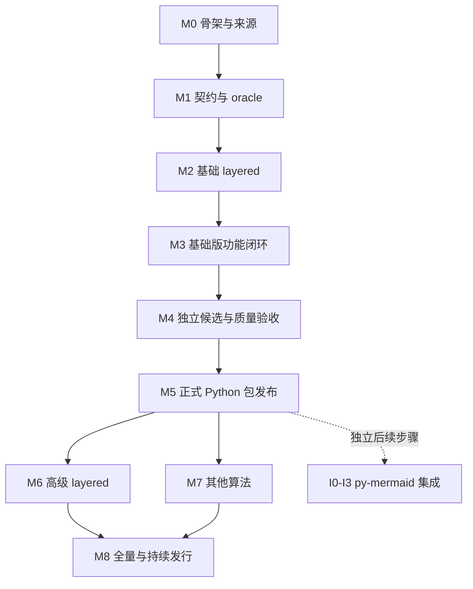

# py-elk 完整实施方案

当前[全部功能已整合到正式源码，统一校验进行中](FULL_NATIVE_IMPLEMENTATION.md)。59 个中间处理器、全部主策略、其它 11 算法、JSON／元数据／递归及持久 worker 已接线；活动修复位置为 `src/pyelk`。下方第 18／19 批的“待实现”描述保留历史语境，不能覆盖机器索引和当前状态。

2026-11-04 用户要求调整实施顺序：采用[先完成全部功能，再统一校验与修复](IMPLEMENTATION_FIRST.md)。实现阶段取消逐模块采集/差分/独审等待，四路同时实装全部功能，只保语法/导入/接口接线检查；统一验收完成前不提升发布及算法通过声明。下方历史审查/验证顺序以该决定为准。

当前按 [19 brief](iterations/NEXT_NATIVE_19.md)执行，18 批成果与限制见[复盘](retrospectives/NEXT_NATIVE_18.md)。新增完整 Polyline、两种 LongestPath、DepthFirst、Simple 和两类非空标签调用已按范围验收；继续 Coffman–Graham、comments、其它 P1 与实际默认值桥。实现时同时核结果、调用顺序和默认值，交叉独审后尽快接真实消费者。独立重写文件使用 MIT，按[发行决定](E11_LICENSE_PROPOSAL.md)逐文件确认来源。

用户最新规则：持续goal完成剩余E09–E21迁移；[变更校验政策](VALIDATION_POLICY.md) 优先。开发只运行变更相关校验，全部功能完成后再统一全量；下文旧逐轮full要求不再作为当前收口前置。

执行效率改进按[E08-00准备批次](iterations/E08-00.md)落地：审计依赖复制瘦身、旧断言迁移预检、固定来源解析复用、按变更范围复验、请求执行去重及提前集成的协作方式。每项均保留原有验收门禁，收益以同机实际前后测量为准；E08公共API实现接在该批次之后。

2026-11-03更新。目标是原生 Python 图布局引擎：以锁定 elkjs 0.12.1 为行为真值，逐项迁移数据、API、元数据、选项和算法，为 py-mermaid 提供布局后端。本文的阶段目标不表示已经实现。

本文定义实现策略与M0–M8架构；具体执行顺序、每轮文件/任务/验收见 [ITERATION_PLAN](ITERATION_PLAN.md)，机器进度索引见 [iteration-plan.json](iteration-plan.json)。
并行推进按 [PARALLEL_EXECUTION](PARALLEL_EXECUTION.md)：root协调/集成，A/B/V按文件独占拆分；每轮先brief/接口、再并行交付和反审、稳定验收，最后复盘并改进下一轮安排。

## 1. 边界与当前事实

| 项目 | 当前约定 |
| --- | --- |
| 唯一行为基线 | elkjs 0.12.1 / `624ae90aa37110033a8af59c5ccbb292708b4317`，npm integrity 和发行文件 SHA 见 [UPSTREAM](../UPSTREAM.json) |
| Python | 目标 CPython 3.11+；导入名 `pyelk`，拟定发行名 `py-elk`，版本 `0.0.1a0` 为本地实验开发包 |
| 运行时 | Python 自行计算；不依赖 Node/JS 解释器、JVM、浏览器、`.local` 或其他布局引擎 fallback |
| 输出 | ELK JSON 中的坐标、尺寸、端口、标签、sections、容器及诊断；不输出图像或承担文字 shaping |
| 已有产物 | 包元信息、来源锁/索引、默认元数据/覆盖账本、有序模型/九项解析/context、真实ELK受限切片及安装对照工具 |
| 验证工具 | 25例官方graph/错误/副作用、完整差分、平面正交几何、确定性、负控制；见[操作手册](LAYOUT_VALIDATION.md) |
| 未完成 | 完整API/算法/断言映射、生命周期/性能、集成及正式发行验收；已实现的受限四方向/多组件见[E07手册](E07_DIRECTIONS_COMPONENTS.md) |
| 上层关系 | py-mermaid 将其布局后端替换成 py-elk；不建立旧 ELK 兼容分支或旧版本坐标验收 |

真实默认注册分母是 **12 个算法、243 个选项、8 个类别**，不是 Python 可用能力。elkjs 仓库索引有 64 个文件，其中 14 个 Mocha 测试文件；文件数不等于独立断言数，也不是 Java ELK 全部测试的数量。逐项状态见 [compatibility](compatibility.json)。

源码来源存在一个明确缺口：锁定 elkjs 的 build.gradle 读取外部 `../elk`，其 CI 使用外部 ELK 的 `master`。当前 Java 算法源码的精确提交仍 unresolved。**npm 发行物是行为 oracle；不能把任意 Java tag 或在线 master 当作同一实现来源。** M1 要建立生成物与可读 Java/Xtend/MELK 的映射，锁 commit/版权/许可及相关测试后再机械移植。

原始四份设计文档已保存。目录初始没有 `.git`；连接器查询预期远端返回不可访问，故不沿用旧文档“已创建组织仓库”的完成结论。Git 初始化、远端访问、commit/push 与发布分别按实际授权和状态处理。

## 2. 总体架构

```text
ELK constructor options + layout(graph, args)
  -> explicit Python/JS value adaptation and input snapshot
  -> ELK JSON validation / ordered identity index / endpoint resolution
  -> option IDs / types / scope / precedence / algorithm selection
  -> ordered internal graph and per-call execution state
  -> recursive engine / component handling / algorithm-specific phases
  -> shared geometry / ports / labels / routing / packing
  -> container-aware transfer into preserved JSON fields
  -> result + diagnostics / logging / execution time

development only:
same case -> locked official elkjs -> raw JSON / error / side effects / metadata
          -> Python candidate     -> raw JSON / error / diagnostics
                                   -> independent constraints and full field-path differences
```

| 模块 | 职责 | 不承担的职责 |
| --- | --- | --- |
| 公共 facade（M1 建立） | ELK 构造、coroutine、参数/异常、查询、生命周期 | 不模拟 Promise.then，不执行 JS worker |
| `model` | JSON 适配、稳定有序图、ID、node/port/label/edge/section、原始字段保留 | 不根据文字长度估节点尺寸，不混入 Canvas 对象 |
| `options` | 标准 ID/唯一后缀、类型、枚举、默认、作用域、优先级和能力检查 | 不把未知选项与已知但未实现选项混同 |
| `execution` | 每次调用状态、调度、取消/关闭、日志/计时、递归布局协调 | 不凭 `async def` 宣称 CPU 任务已经隔离或可以及时取消 |
| `algorithms/layered` | 破环、分层、交叉最小化、坐标、路由和中间 processors | 不把一般分层图算法当作 ELK 坐标实现 |
| `algorithms` 其他子模块（待建） | 11 个其他算法及其专用选项 | 不以返回现有坐标、另一算法或默认 layered 冒充实现 |
| `geometry` | 向量/矩形/折线、交点、容器坐标变换、路由/打包公共计算 | 不提供独立绘图库 |
| `metadata` | 实际实现/注册的算法、选项、类别及适用能力 | 不把参考快照直接返回为支持列表 |
| py-mermaid adapter（独立 I 阶段） | 上层模型到 ELK JSON、结果回填、选项映射、版本与取消传播 | 不将 Mermaid parser/theme/Canvas 迁进 py-elk |

当前已有实际model/options/execution与受限layered模块，顶层公开ELK及版本；其他算法/几何公共能力与完整元数据注册仍待实现。内部图顺序、PRNG状态、工作列表及registry生命周期必须显式定义，已有每call隔离不能替代完整并发/取消/资源验收。

## 2A. Python实现策略

### 以源码解释行为，以固定发行物验收

执行方式为“可追溯的语义移植 + 分阶段差分验证”。Python模块、类型和数据结构按项目职责组织；影响布局的默认策略、处理器顺序、排序与tie-break、随机状态和数值规则逐项对应锁定实现。
每个移植单元建立 `source commit/path/symbol/SHA → 条件与默认值 → Python symbol → assertion → evidence`。
先沿基础layered默认执行路径移植它实际触发的阶段与processors，其他策略后续扩展。

行为真值是锁定npm发行物；可读Java/Xtend源码负责解释算法。E01先审计并记录Java工程、构建/生成链和首版组件对应关系。
来源状态至少区分“发行物已锁定”“可读源码已定位”“源码与生成物关系已核实”，三者不能互相代替。
完整Java工程未闭合时，JSON/选项/探针工作继续；进入某个算法组件的机械移植前，该组件必须有可审阅的版本映射和版权/许可处理记录。
若使用发行bundle中的可追溯实现作移植来源，也要记录实际文件SHA、符号/范围、生成代码身份与验证证据，不能把另一个Java提交写成其准确来源。
审计得到未解决项时保留具体缺口及下一项可执行调查；完成一次审计不自动表示来源门禁通过。

### Python基础设施先服务于真实执行链

内部图保留节点/边/邻接列表的稳定顺序，ID索引只用于查找；不依赖集合遍历顺序决定布局。
调用状态、随机流、临时节点/边、方向变换和诊断归属每次执行上下文；业务字段与计算模型分开保存，导出时按原身份回填。
Python层使用明确类型和模块接口；Java整数溢出、JS数值/缺失值、浮点运算顺序、比较器、Unicode等差异只在已核实的调用路径上实现并测试。
固定seed只保证输入条件一致；需要随机流兼容时，算法、种子初始化、消耗顺序和整数运算都要对应，不能直接假定Python标准random的输出一致。

默认执行路径形成可检查的phase/processor清单，记录每项启用条件、读写字段和源符号。
首个单边切片也走这条真实路径及其适用的处理器；特殊空图/单点分支有上游依据。
尺寸、间距、端点与根边界来自算法计算，不把fixture坐标、截图、参考输出或针对案例ID的分支放进运行时代码。
已知但未实现且会改变布局的选项/拓扑应明确拒绝；API/元数据只声明真实已支持范围。

### 先完成纵向切片，再增加输入与策略

第一条端到端链为：输入/选项 → 有序内部图 → layered默认阶段 → 节点坐标 → 正交section → 根尺寸/JSON回填 → 公共ELK调用。
按空图/单点/单边 → 链/分叉/汇合/菱形/长边 → 环/自环/多边 → 四方向/组件/首版选项扩展。
阶段依赖可以提前建设，公开支持范围只随端到端证据扩大。内部phase完成、实验性坐标可用和正式坐标兼容分别记录。
E04开始提供真实候选runner；初期只验明确登记的切片套件，同时保留全量套件中的未支持项。E09才收口首版全部声明分支。
每次调整API/能力状态，同步范围例子、UPSTREAM、兼容账本、双语README和新会话状态；当前这些文件中写死的零能力不能在实现后继续作为真实统计。

### 阶段诊断与端到端差分共同定位问题

可选开发trace按执行顺序记录阶段、原始ID/临时ID映射、反向边、层号/顺序、随机状态、虚拟节点、坐标与路由恢复信息。
trace另存为研发证据，不混入默认ELK JSON输出。阶段断言验证不变量；能从固定参考构建获得的中间证据另存并记录获取方式，不能假设当前oracle能导出所有内部阶段。
中间结果有差异时先找首个偏离阶段，再追踪选项、排序、随机或数值原因；最终以独立几何和完整JSON/坐标差分共同验收。
每次新增能力补充尺寸/间距/输入顺序/seed/拓扑变体和明确非法输入；固定seed生成的图作为泛化补充，不以既有25例或随机样本数代替声明分支覆盖。
对称图存在多种合法布局时仍分别记录几何合法与坐标一致；只有后者满足声明的坐标兼容要求。

### 先冻结宿主适配，再扩大兼容声明

E02输出版本化的兼容决策：Python输入保留目标与FakeWorker原地修改的关系、GWT生成的`$H`、错误名/消息映射、默认/空参数、关闭/并发/取消边界。
保留现有严格原始合同差分；若为原生Python定义公开语义profile，另加显式规则与独立结果字段，列出实际适配路径、原因和所有被适配字段。
区分用户原本提供的业务字段与参考运行新增的私有数据；不按字段名通配删除，不重写生成section ID，不对坐标平移/缩放或排序模型数组。
profile实现须增加适配正例、用户同名字段/非适配路径负例和原始差异仍可见的回归。
公开布局兼容、宿主行为差异、几何通过、坐标通过和生命周期验证分开陈述；新profile在实现并验证前不能作为当前脚本已有能力。
既定坐标容差继续为`abs_tol=1e-6`、`rel_tol=1e-9`，不因实现困难扩大。

### 以独立正式包结束首条主线

E01–E12对应基础0.1.0：先真实基础能力，再API/生命周期与声明收口、平台/性能、同一候选安装验证和正式发布/下载复验。
运行时仅Python；参考Node、worker、Java、oracle、golden和开发trace不随可用算法打包。
E13–E21扩展高级layered、其他11个算法和全量发行；I0–I3是E12后的独立集成分支，能力缺口对应依赖后续正式版本。
执行期间以小批改动交付可复现证据，每轮完成条件、失败原因和下一步写入迭代索引；日历估时以实际工作量和测量为依据。

## 3. M0：可持续开发的项目入口

交付：Python 包元信息/类型标记、模块职责、双语 README、启动资料、来源与元数据锁、完整算法/选项清单、bootstrap CI、负控制、无布局冒充的例子、许可状态。

本轮同时核对 Git canonical blob、npm tarball integrity/gitHead/发行文件、默认注册快照和源文件索引。开发工具可以运行 Node；安装后的 Python 包不能携带参考 worker/Java/测试快照。CI 配置与实际远端 CI 结果分开记录。

门禁：bootstrap/负控制通过、来源可重验、所有支持状态诚实、候选骨架能隔离导入且只导出版本；这不代表布局通过，也不允许发布占位包。

## 4. M1：完整契约、来源与官方 oracle

### 4.1 把来源拆成独立断言

建立 `source → case → assertion → Python symbol → evidence` 关联，字段包含稳定 ID、upstream commit/path/symbol、source SHA、constructor/args、原始输入、期望结构/错误/副作用、seed、比较 profile、适用条件及状态。展开动态/参数化测试、多断言、负例、文档公开行为、generated/importer 行为、策略枚举和 Java 端相关回归，不以 14 个文件或 25/50 张图充当完整覆盖。

源码映射分别记录算法概念、独立实现、直接移植代码和生成代码；每个移植入口包含默认值、参数/单位、返回/异常、数值与字符串边界、状态/所有权及独立回归。Java 来源未闭环时，API/JSON/oracle 工作仍可独立进行；未映射来源保留 open。

### 4.2 公共 API 与宿主差异

覆盖构造器和五个方法：layout、knownLayoutAlgorithms/Options/Categories、terminateWorker。冻结构造参数缺省/null/空对象、algorithms 的缺省/空数组/筛选/未知项、各入口与 worker 模式的实际注册差异。

已确认构造默认选项与调用级 layoutOptions 是**替换关系**：调用未提供时使用构造默认；显式 `{}` 也会替换，不能逐键合并。随后核实元素局部选项的优先级、作用域及继承；不要凭“父级配置”推断所有属性可继承。

Python/JS 映射至少覆盖：missing/null/false/0/空串、整数与字符串 ID、Number/非有限值/负零、数值序列化、对象与数组顺序、Unicode/UTF-16、PRNG/seed 和错误分类。TypeScript 里选项值写 string 不等于运行时只接受 string。

bundled FakeWorker 的实际 terminateWorker 抛错已留证。Python 的无 worker 关闭、重复关闭、关闭后调用、并发、取消和资源清理要形成明确适配决策；不能悄悄把差异算成兼容。`workerUrl/workerFactory` 是宿主映射项，首版显式拒绝的设计仍需测试和文档。

### 4.3 JSON 与几何契约

保留 root/children/ports/labels/edges/layoutOptions、业务字段、primitive 和 extended edges、sections/incoming/outgoing 引用、junction points、已有几何与 container。节点、端口、标签和边的坐标系分别核对，覆盖相对父节点、edge container、跨层级、JSON 坐标模式和回填规则。

重复/缺失 ID、整数与字符串冲突、缺端点、零/缺省/负尺寸、空图、自环、多边、长边、环、非连通、hyperedge、未支持拓扑/算法组合均有负例。多源多目标不能静默展开。调用方提供标签尺寸；py-elk 不猜测字体尺寸。

### 4.4 官方采集与比较器

固定 Node、入口、包 integrity、constructor/args、输入顺序与随机种子；保存原始结果、异常、日志、输入是否变化、模块/实例状态和环境 SHA。注册范围的变体要在独立进程中采样，避免模块静态状态污染。

比较分层：API/JSON/错误 → 独立语义和几何约束 → 每个数值路径坐标差分 → 生命周期/稳定性/性能。不排序模型数组、不删业务字段、不平移/缩放/居中坐标来制造一致。日志时间等明确非确定字段单独报告。

保留原设计 `abs_tol=1e-6`、`rel_tol=1e-9` 为坐标 profile，另报 exact、最大绝对/相对误差和所有超限字段；semantic-only 只是实验性结果。不同算法需要更宽标准时先形成理由/证据和决策，不能修改全局阈值掩盖问题。节点/端口/section、默认值、seed、错误类型和字段删除负控制必须失败。

门禁：Java/source/license 映射达到相应移植入口所需精度、首版范围的断言清单及 oracle/profile 可审查；同输入重采可解释、比较器能检出破坏。完整分母继续保留；非首版算法/选项的断言细化可随 M6/M7 扩展。已采集默认元数据不等于整个 M1 完成。

## 5. M2：基础 layered 的真实垂直切片

顺序：稳定有序图 → 基础预处理/组件 → 破环与方向恢复 → 分层及长边虚拟节点 → 层内排序/交叉计数 → 可变节点尺寸坐标 → 正交边路由/sections → padding/四方向/根尺寸 → JSON 回填。

每阶段核对 processor 顺序、排序/tie-break、随机状态、数值单位和中间产物。默认策略从锁定实现/参考用例冻结；未实现策略明确失败，不用一般分层图或硬编码单边坐标冒充 ELK。

首批输入覆盖空图、单点、单边、链、分叉/汇合、菱形、长边 DAG、环、自环、多边、非连通和变尺寸节点，叠加方向、间距、padding、模型顺序和负例。图集数量是组织方式，完成标准按全部声明分支的断言和几何/坐标结果确定。

M2 门禁：原生 Python 真实计算、明确实验性范围、完整结构/几何/数值差分。它不是正式发布验收；存在坐标差异的路径继续记录，M3 闭环后再纳入首版。

## 6. M3：独立基础版功能闭环

首版完整范围见 [FIRST_RELEASE_SCOPE](FIRST_RELEASE_SCOPE.md)和 [release-profiles](release-profiles.json)。计划首个正式版本为0.1.0；当前0.0.1a0是本地实验开发包，受限切片不替代正式基础范围验收。

基础版采用单层图、字符串 ID、给定节点尺寸、单源单目标 extended edges、基础拓扑和正交路由；冻结 9 项核心选项、完整 ID/elk.* 别名、构造/调用替换和元素优先级。输入保留、错误分类/路径、seed/顺序、async/关闭/并发边界均有独立测试。元数据查询只暴露实际实现范围。

端口、独立标签布局、compound/跨层级、primitive/hyperedges、更多路由/策略和其他算法仍保留全量分母，首版显式拒绝尚未支持且会影响布局的输入，后续 M6/M7 实现。不得丢字段、忽略约束或换算法后返回“成功”。

M3 门禁：首版支持范围的 API/选项/结构/几何/坐标断言闭环；声明坐标兼容的路径达到原有 `abs_tol=1e-6`、`rel_tol=1e-9`，所有差异原样保存。semantic-only 原型不计正式兼容通过，不能以“有坐标”代替就绪。

## 7. M4：基础包的独立质量与候选验收

建立可复制的独立 Python 调用、公共类型/异常、输入/选项/平台支持表、限制和基本性能基线。首版没有 py-mermaid 或 Canvas 依赖；上层集成测试不进入这一门禁。

验证 CPython 3.11–3.14 和 Windows/Linux 的真实布局、实例状态、异常恢复、声明的关闭/并发/取消行为、图规模/深度/资源上限。先测量节点/边/密度/seed/硬件对应的耗时和峰值内存，再确定可声明的范围，不虚构吞吐或总工期。

构建新的 wheel/sdist，记录源码/构建输入/候选 SHA，审查包中没有 worker.js/Java/.local/oracle/golden。仓库外 `python -I`、无 Node/JVM/浏览器 PATH 的新环境执行真实布局；骨架 import 不满足门禁。相同候选字节接受安装、API/几何/性能、类型和文档检查。

M4 门禁：首版功能范围与真实候选独立验收通过、许可/名称/发布准备可审查；整个过程不等待 py-mermaid 适配。

## 8. M5：发布首个正式 Python 包

计划发行名 `py-elk`、导入名 `pyelk`、正式版本 `0.1.0`（无 alpha/rc 后缀）；名称/账号权限在发布前重新核实。基础版不是完整 ELK 兼容声明，其余算法/选项仍在公开清单中。

先闭环自有发行许可及实际移植的源码版权、EPL/secondary-license 和第三方通知。原有“发行许可待定”状态仍有效；不把 py-mermaid 许可直接套用，不以未定许可的空骨架占名。

在 M3/M4 证据完整后，准备准确的 PyPI README/METADATA、支持矩阵、版本说明和真实例子，上传同一已验收候选，核查索引页面/文件，再重新下载核 SHA并执行安装及布局。记录具体版本、URL、命令、退出码和下载/布局结果。

M5 完成才称“基础 py-elk 正式 Python 包已发布”。用户已明确该发布目标；执行前完成具体候选和必要的名称/许可/账号输入，不用抽象计划代替可审阅结果。本轮结构规划不具备布局/许可/发行验收，不上传占位包。

## 9. M6：正式基础包之后的高级 layered

独立实现端口 side/index/固定顺序/位置/比例、端口锚点和节点尺寸约束；node/port/edge labels 的给定尺寸/位置/间距；递归、compound/cluster、跨层级边和容器坐标模式；复杂自环/反馈边、section 引用/汇合及适用的 hyperedge/primitive 格式。

扩展全部破环/分层/交叉最小化/节点定位策略和中间 processors；正交/折线/样条路由、component packing、模型顺序及适用选项组合。每个选项记录 ID/别名、类型/枚举/默认、单位、targets、继承/覆盖、算法适用性和独立断言，不以注册描述冒充生效。

M6 门禁：layered 的全声明策略/适用选项/拓扑有证据、各容器坐标回填和端点可追踪、默认值/PRNG/数值路径已核对。随机压力输入是补充，不用“100 个图通过”代替专题清单。

## 10. M7：其余 11 个算法

| 批次 | 算法 ID 后缀 | 独立重点 |
| --- | --- | --- |
| M7-A | `fixed`、`box`、`random` | 已有几何转移、分组打包、随机流/seed/范围、尺寸和适用选项 |
| M7-B | `mrtree`、`radial` | 根/森林/方向、子树/层顺序、间距/圆周几何、非树输入 |
| M7-C | `force`、`stress` | 初值/seed、迭代/力或应力、收敛/终止、质量与逐点数值差异 |
| M7-D | `disco`、`sporeOverlap`、`sporeCompaction`、`rectpacking` | 分量/形状打包、重叠移除/压缩、输入位置、目标函数/约束和质量 |

11 项加 layered 恰为默认注册的 12 项。每个算法独立 source map、元数据/默认参数、全部适用选项、正负输入、结构/几何/坐标、随机/终止和性能验收；不回退另一个算法。

这些扩展不阻塞基础 0.1.0 发布。技术原型可在公共模型稳定后准备，但不抢占 M1–M5 的发布主线；对外版本按实际已验范围逐步扩大。

## 11. M8：全量兼容与持续发行

覆盖 API 六项、12 算法、243 选项、8 类别及跨领域清单。分别报告总分母、已拆分、实现、各级通过、差异、失败、unsupported、open、未验；不隐藏 skip。

完整矩阵包括各 Python/平台、JSON round-trip、seed/顺序/重复布局、无状态污染、并发/取消/关闭/恢复、深度/规模/时间/内存、无 Node/JVM/参考源码运行。性能分 import/options、各 phase、routing/export 与整体耗时/内存，固定质量策略和环境。

新版本重新绑定候选/源码/文档/许可和支持范围；正式基础包发布不自动等于未来全量验收。py-mermaid 仍在独立 I 阶段验收，不作为本项目完整算法证明或独立发行的必要条件。

## 12. 独立 I 阶段、依赖与下一批

py-mermaid 集成单列 [MERMAID_INTEGRATION](MERMAID_INTEGRATION.md)的 I0–I3，使用 M5 已发布版本。若上层需要端口/层级等高级能力，再依赖 M6/M7 对应新版本；它不反向阻塞基础包发布。不维护旧 ELK 版本兼容分支。



高风险项尽早处理：Java/生成物来源、默认值、PRNG/浮点、基础路由和许可；先冻结首版范围，再扩完整目标。改变兼容语义/阈值时准备具体 case、原始差异与影响；普通实现选择直接推进。

E01–E07已有证据：宿主基础、真实19/21/23/25调用链、受限多重图/长边、四方向与多连通分量，72输入验收以[E07记录](changes/20261103-E07.json)为准，复跑见[E07手册](E07_DIRECTIONS_COMPONENTS.md)。按[机器进度](iteration-plan.json)进入E08；新增API/调度/helper与数值分支先重核来源/版权，再机械移植，不泛化E07限定域审批。
已有graph capture/compare/负控制和显式profile直接复用，继续扩展切片套件与算法断言；完整M1门禁仍由 [TASKS](TASKS.md) 的M1-01…08验收。

每批保留修改前状态、原始失败/oracle、完整数值差异和新证据，source map、回归、双语入口、契约/任务/状态及真实例子同步更新。没有新布局能力时说明相关示例为何不变；不虚报工期或覆盖率。
