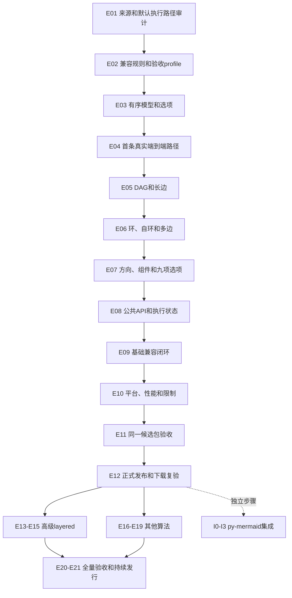

# Python实现迭代执行计划

当前状态（2026-11-04）：[完整实现已合入正式 src，进入统一校验与集中修复](FULL_NATIVE_IMPLEMENTATION.md)。196 个 Python 模块语法/导入通过；12/243/8 完整接线尚未代表正确性通过。`.local/migration-next` 已冻结；本阶段修复直接改 `src/pyelk`。下方旧私有批次与切片状态仅按其日期作历史记录。

最新执行顺序见[先实现后统一校验](IMPLEMENTATION_FIRST.md)：全部功能实装与接线 → 集中对照/完整验收 → 集中修复及影响复验 → 发行收口。第 19 批起不以 getter/helper/单份审查扩拆批次，不再等待逐模块源审与差分门禁；A/B/V/Root 都承担实现。

实际实现已越过第 19 批，全部进入 `src/pyelk`。当前按 [任务账本](implementation-backlog.json)收口 MrTree 修复、新候选、选项效果与正式发行；不要重复第 18/19 批的实现任务。机器计划已将 E13–E21 标为执行中的实现完成／验收待收口，未以有限证据声明全部通过。

用户最新规则：持续goal完成剩余E09–E21迁移；[变更校验政策](VALIDATION_POLICY.md) 优先。开发只运行变更相关校验，全部功能完成后再统一全量；下文旧逐轮full要求不再作为当前收口前置。

2026-11-03。策略依据为 [IMPLEMENTATION_PLAN](IMPLEMENTATION_PLAN.md) 的“2A. Python实现策略”，工作包编号沿用 [TASKS](TASKS.md)。
以下保留原始批次及退出条件，不改变 M0–M8 的验收定义。早期切片描述属于历史；当前实现和检查范围以顶部入口与机器状态为准。
每轮按 [PARALLEL_EXECUTION](PARALLEL_EXECUTION.md) 的逐轮A/B/V分工、文件独占、稳定屏障和复盘规范执行；root统一集成与更新状态。
**E07提供受限四方向、多连通分量与九项基础选项；E08接入真实异步执行、元数据与生命周期，精确范围见[E08 brief](iterations/E08.md)。随后按[E09 brief](iterations/E09.md)收口基础版声明，新增支路先续核来源。** 最终完成状态、依赖和工作包对应关系以 [iteration-plan.json](iteration-plan.json) 为准。

## 1. 执行顺序与共同完成条件

原计划分 E01–E12 基础发行和 E13–E21 后续扩展。用户已改为先实现全部迁移再统一验收，因此 E13–E19 已在首次正式发行前实施；原退出条件继续逐项核对。I0–I3 的 py-mermaid 集成继续单独后置。
迭代按退出条件推进，可以跨会话；不以未经测量的天数、代码量或样例数量作为完成标准。
依赖表示必要前置，编号表示默认推进次序。E16–E19的算法扩展不必相互等待；实际代码依赖在source map中核实后补入索引。



每轮按以下次序工作：读取当前状态和已有证据 → 固定本轮输入/来源/断言 → 小批实现 → 相关回归与差分 → 记录差异和限制 → 更新索引及文档。
交付记录包含iteration/work-package ID、实际源SHA、实现符号、case/assertion、命令/退出码、完整差异、能力变化、open项与下一步。
完成需要实际交付和验收证据；“代码写完”“有坐标”“语义约束通过”不自动代表坐标兼容。
只有声明分支对应证据可以提升兼容账本状态；完成一次迭代不自动提升整个算法/243选项为通过。
本页所列待建文件均为拟定代码落点，可以按已核实源码细化，不能把规划文件名登记成已存在的实现。

## 2. 验收配方与当前可执行边界

| 配方 | 检查内容 | 当前情况 |
| --- | --- | --- |
| V0 | 结构/文档/来源指纹、工具回归、官方快照与负控制 | 已有check.py |
| V1 | 固定发行物实际重采和官方快照回放 | 已有reference/replay |
| V2 | 相同切片suite的真实JS/Python差分、几何与重复确定性 | E04真实wheel同21例各3次通过，见[E04手册](E04_NATIVE_SLICE.md) |
| V3 | phase不变量、模型/选项/错误/生命周期与泛化回归 | E03基础及E04算法/API/conformance已接入；完整生命周期待E08 |
| V4 | 真实布局平台矩阵、性能/峰值内存、资源上限 | E10交付脚本与原始报告 |
| V5 | 同一wheel/sdist、仓库外隔离安装、真实布局、运行时资源检查 | E11交付脚本与候选SHA |
| V6 | 上传、索引核查、重新下载SHA与隔离布局复验 | E12交付正式版本证据 |

当前可直接运行V0/V1；每次使用新目录：

```shell
python scripts/check.py --out test-runs/E01-start-01
python scripts/upstream.py fetch
python scripts/check.py --with-reference --out test-runs/E01-oracle-01
```

来源/采集失败时保留原日志；不刷新lock/快照或扩大容差掩盖失败。
check.py已接入E04算法/API/conformance及source/runtime审计；新增测试组时仍须同步入口/CI，工具自测、源码对照与真实安装分别报告。

E04开始，每个阶段由master案例表生成独立suite：复制被选请求的原始字节，登记来源case ID、请求SHA、入选/排除原因和master分母。
当前contained规则要求请求位于suite目录内部，不能用`../../validation/requests`绕过；suite构建器在E04新增。
同一个suite必须同时用于reference与candidate，两者suite/请求SHA一致；不能拿完整官方capture直接比缩减candidate。
阶段suite明确保留未支持项清单。E09必须运行首版完整声明套件，不能把阶段性排除继续当成正式通过。

以下命令适用于已安装真实E04开发包的解释器；需要确认安装内容时优先使用[E04手册](E04_NATIVE_SLICE.md)的`check_e04_slice.py`：

```shell
python scripts/validate_layout.py candidate-command --out test-runs/E04-command-01.json
python scripts/validate_layout.py reference --cases tests/fixtures/suites/E04/cases.json --out test-runs/E04-reference-01 --repeat 3
python scripts/validate_layout.py candidate --cases tests/fixtures/suites/E04/cases.json --command-json test-runs/E04-command-01.json --out test-runs/E04-python-01 --repeat 3
python scripts/validate_layout.py compare --profile native-basic-layered-v1 --determinism-policy elkjs-0.12.1-default-seed-v1 --reference test-runs/E04-reference-01 --candidate test-runs/E04-python-01 --out test-runs/E04-diff-01.json
```

严格模式原样报告JS副作用/私有字段差异。E02已交付显式`--profile native-basic-layered-v1`，默认strict不变；V2按冻结规则和完整原始差异验收，命令与限制见 [手册](LAYOUT_VALIDATION.md#显式原生合同profilee02)。
V3已有E04阶段/API回归和受限安装入口；V4–V6的完整性能、候选与发布验收仍按后续轮次交付。

## 3. E01–E03：先具备可移植、可验收的基础

### E01 来源、许可处理与默认执行路径审计

工作包：M1-01、M1-02；前置：现有来源与工具基线。

1. 执行V0/V1，确认固定commit、npm文件、25例与现有失败观察；建立新的本轮证据目录。
2. 沿入口、JSON导入、默认策略选择、phase/processor、几何导出追踪基础layered；列出启用条件和默认值的来源。
3. 调查可读Java/Xtend与生成worker关系，按组件记录版本、路径、symbol、SHA和版权/许可处理；未知对应关系明确列open。
4. 建立source → assertion → Python symbol映射，分清项目自行编写case与上游断言；列出首个切片必需组件和尚缺证据。

拟新增：`references/port-map.json`、`references/layered-default-path.json`、本轮来源/许可调查记录。
验收：V0/V1及可审查的来源/默认路径表；每个缺口有具体下一步。审计批次完成与`algorithm-source`门禁通过分别记录。
门禁：E04实际执行的每个算法组件必须通过来源及许可处理核查。整套Java工程尚未闭合时，可继续E02/E03；不能让未闭合组件进入机械移植。

### E02 兼容规则、宿主适配与验收profile

工作包：M1-03、M1-05、M1-06、M1-08；前置：E01审计结论，不要求整个Java工程已闭合。

1. 补采构造缺省/空值、调用选项缺省/空对象、局部覆盖、ID/数值边界与错误形态，核实九项选项的默认/作用域。
2. 冻结输入不变目标与FakeWorker副作用的关系、`$H`生成数据范围、异常名/消息、worker参数、关闭/并发/取消的Python映射。
3. 用版本化决策文件定义原生公开合同profile。保留现有strict完整差异；另报公开合同、适配字段/原因、坐标和未验证项。
4. 在比较器交付显式profile选择，默认strict；补充业务同名字段、用户原有`$H`、生成section ID和非适配路径破坏负例。

交付：`docs/decisions/0001-native-contract.md`、`references/native-contract.json`、56组`e02-contract-probes.json`及`e02-audit.json`；比较器、CLI、合同检查与独立回归。
验收：V0/V1；适配与原始差异可同时查看，业务字段/顺序/坐标错误仍失败。原生profile不能把所有结果差异都转成允许项。
门禁：`native-contract`已冻结并可执行。更新API_COMPATIBILITY/LAYOUT_VALIDATION，不把拟定profile写成当前已有行为。

### E03 有序内部图、JSON/选项与调用上下文

工作包：M1-04、M1-05、M2-01；前置：E02。

1. 实现root/node/edge模型、稳定顺序与ID查找，检查端点、重复ID、尺寸和业务字段，支持无损导入/导出；依据E01路径补齐内部port/锚点/尺寸与margin数据，公开ports未支持不代表内部无需这些结构。
2. 实现九项选项的完整ID/别名、类型与枚举、缺省、构造/调用替换和局部优先级；明确区分未知与已知未实现项。
3. 实现每次调用的工作图、临时state/快照和seed配置接口；实际随机流与首切片数值路径在E04来源闭合后实现和回归，不把Python random当Java流。
4. 模型可承载ports/层级/labels/hyperedges数据，但不提供其布局语义；primitive边/未知及已知未实现配置明确失败，保留业务字段，不提供成功布局stub。

已交付：`src/pyelk/model/`、`options/`、`execution/`实际模块与共享JSON/错误类；foundation/model/options/execution独立测试、来源/声明审计。用法见 [HOST_FOUNDATIONS](HOST_FOUNDATIONS.md)。
验收：V0和新增V3；round-trip、输入保留、顺序、参数替换/别名、非法输入与调用状态隔离通过。尚未实现的布局保持明确不可用。
门禁：`ordered-model-options`通过；只为实际算法需要建立公共抽象。

## 4. E04–E07：真实基础layered端到端扩展

### E04 第一条真实路径：空图、单点、单边和链

工作包：M1-06…08、M2-01/03…06；前置：E03及`algorithm-source`、`native-contract`。

1. 按已核实的默认phase/processor启用规则实现最小执行链，包含输入处理、层/顺序、节点坐标、正交路由、根尺寸与导出；E01单边默认实测19次调用，须保留两次不同配置的LayerSweep及实际内部ports/labels/margins处理，不能仅实现五个主阶段。
2. 公共`ELK`实际调用该执行链；空图/单点特殊路径有来源，不按case ID或参考坐标分支。
3. 增加固定seed的双节点请求及尺寸/间距/模型顺序变体，建立E04 suite构建器并记录完整未支持分母。
4. 安装真实本地候选，接入已有candidate adapter；添加可选阶段trace，将实际支持范围写入例子/能力状态。

拟新增：`src/pyelk/elk.py`、`algorithms/layered/pipeline.py`及所需phase模块、`geometry/`、`scripts/build_validation_suite.py`、首批真实layout例子。
验收：V0/V2/V3；空图、单点、单边和链在默认方向下真实计算，泛化尺寸/spacing输入也通过；缺能力明确报错。
门禁：第一条Python算法路径有完整原始差异、几何/坐标和3次重复证据。只声明已验切片，不能标整个layered完成。

### E05 DAG、长边与默认阶段闭环

工作包：M2-03…06；前置：E04，并继续核查新增执行组件来源。

1. 实现默认分层、长边虚拟节点/边和恢复规则。
2. 实现默认交叉最小化、tie-break、随机消耗与节点定位；补齐DAG触发的processors。
3. 完成分叉/汇合/菱形/不等尺寸/长边的正交section与根边界，trace对应原始身份。
4. 补充多层、多出入度、输入顺序和seed变体，确保临时对象不会泄漏到输出。

代码落点：layering/crossing/positioning/routing/restoration及必要execution数值/随机模块。
验收：V0/V2/V3；各phase不变量与完整端到端差分通过。多种几何合法结果不等于相同坐标。

### E06 环、反馈边、自环和多重边

工作包：M2-02…04、M2-06；前置：E05。

1. 移植默认破环与边反向记录，在最终输出恢复方向和端点。
2. 实现自环与平行边各自所需处理器、路由和section身份，保留原边顺序。
3. 增加双向边、多个环、环与DAG混合、多自环/多重边的尺寸/顺序变体。
4. 让几何断言使用各case适用条件：含环不执行全部边必须正向的DAG断言；端点/正交/边界仍验。

代码落点：cycle_breaking/processors/routing/restoration；扩展fixture generator和分阶段suite。
验收：V0/V2/V3；全部原边可追溯且端点/路由/数值通过，无临时反向边泄漏或字段丢失。

### E07 四方向、组件、padding与九项选项

工作包：M2-01、M2-05/06、M3-01；前置：E06。

1. 核对并实现方向转换的坐标、尺寸、路由点和padding语义；四方向均有独立官方结果。
2. 实现组件拆分、分离开关、组件间距/打包及统一根边界，节点/边身份与模型顺序稳定。
3. 闭环九项选项的生效路径、别名、布尔/数字/字符串输入、构造/调用替换和局部覆盖。
4. 增加选项边界与适用组合、零尺寸/不等尺寸、组件顺序/方向/间距交互和未支持值负例。

代码落点：components、geometry坐标转换、options解析、layered导出；扩展首版能力表。
验收：V0/V2/V3；首版九项选项逐项有断言和执行路径，不以“已解析”代替“已生效”。

## 5. E08–E12：收口、质量与正式包

### E08 公共API、元数据与执行状态

工作包：M1-03/06、M3-02/04、M4-02；前置：E07。

1. 闭环构造器、真实异步layout和三项元数据查询；注册表只暴露已实现能力，并记录与全参考目录的范围差异。
2. 实现E02冻结的关闭、重复关闭、关闭后调用、并发/取消/错误恢复策略及worker参数处理。
3. 检查多实例/同实例多次布局、输入/选项复用、失败后成功、随机与临时状态污染。
4. 补齐公共异常/字段路径、类型标记、真实独立例子与async/性能限制说明；同步当前写死零能力的范围例子与统计。

代码落点：elk/errors/metadata/execution；新增contract/lifecycle测试与运行脚本。
验收：V0/V2/V3；异步接口与实际调度/取消能力分别陈述，宿主行为映射单独验收，不从坐标通过推导生命周期通过。

### E09 基础版全部声明分支收口

工作包：M1-02、M3-01…04；前置：E08。

1. 对齐FIRST_RELEASE_SCOPE、release-profiles、API文档、实际代码与机器账本，列出首版每个声明分支对应断言。
2. 运行完整基础suite，不再沿用E04的缩减通过结论；全部25个种子案例及新增分支均有状态。
3. 增加确定性生成的不同规模/拓扑/尺寸/seed/顺序图和非法输入，记录失败收缩后的独立回归。
4. 逐个消除未解释的结构/坐标差异；未支持高级范围明确拒绝，公开合同适配项有单独证据，原始严格差异保留。

交付：首版分支→断言→实现→证据清单、完整能力/限制与支持矩阵、可复现的candidate报告。
验收：V0/V2/V3；声明坐标兼容全部满足1e-6/1e-9既定profile。完整12/243/8分母继续保留。
门禁：`first-release-coverage`通过；有待解决的首版声明分支时不进入正式候选。

### E10 平台、性能与资源限制

工作包：M4-01…03；前置：E09。

1. 在Windows/Linux、CPython3.11–3.14运行同一基础实现的实际布局/API/状态回归；失败或未执行的组合单列。
2. 固定图规模/边密度/尺寸/seed/硬件测量导入、各phase、路由/导出与整体耗时，采集峰值内存。
3. 依据测量定义可声明的节点/边/资源上限及超限行为，验证并发、取消、超时/恢复策略的边界。
4. 增加可重复的矩阵与benchmark脚本、原始数据、环境指纹和说明。

交付：V4脚本与实际平台/性能报告；未测量前不填写吞吐或资源保证。
验收：声明支持的平台均有真实布局证据，资源/生命周期限制可执行且准确。门禁：`platform-quality`通过。

### E11 同一候选wheel/sdist与发布准备

工作包：M4-04、M5-01；前置：E10。

1. 完成发行许可、移植文件来源/版权、NOTICE、名称与账号发布权限核查；冻结正式0.1.0版本与支持范围。
2. 从可追溯源码构建wheel/sdist，记录两者SHA及构建环境；检查metadata/类型/README/例子与包内容。
3. 用最终wheel和由最终sdist得到的安装分别在干净环境/仓库外`-I`运行真实布局；移除Node/JVM/浏览器/仓库源码路径。
4. 自动检查包内无worker/Java/oracle/golden/开发trace，实际运行无参考引擎调用；保存安装及布局原始证据。

交付：V5脚本、最终候选文件/SHA、许可与发布检查记录。候选改变后重新验相应门禁。
验收：`candidate-accepted`通过；安装/验证与拟上传的候选字节一致，不用元信息导入替代布局。

### E12 正式0.1.0发布与下载复验

工作包：M5-02/03；前置：E11。

1. 上传已验收的同一候选文件，记录实际上传命令/结果，不在上传时临时重建未验候选。
2. 核对PyPI版本页、支持范围、依赖、文件与metadata，保存实际版本URL。
3. 在新目录重新下载wheel/sdist，核对候选SHA，再在新环境安装并执行基础布局/API/几何验收。
4. 完整记录正式版本与证据，更新发布状态；上传/索引/下载/布局任一失败均保留失败状态。

交付：V6及可下载真实0.1.0。门禁：`package-published`通过后才称首个正式Python包已发布。

## 6. E13–E21：基础发布后的扩展

扩展均先固定源码/输入/选项，再实现、差分、独立约束与平台/候选验收。新能力需要正式版本时复用E11/E12流程，不必等待全部E21结束。
基础版几何profile不覆盖端口/标签/层级，必须随能力新增独立校验；不能仅靠递归JSON比较就声明新几何已验。

| 迭代/前置 | 工作包 | 具体交付与验收 |
| --- | --- | --- |
| E13 端口与给定标签；E12 | M6-01/02 | 端口side/index/固定顺序/位置/比例、锚点/节点尺寸；node/port/edge label已给尺寸的定位/间距。新增独立端口/label约束及适用组合差分 |
| E14 层级与容器；E13 | M6-03 | compound/cluster、递归与跨层级边、JSON坐标模式、容器回填/端点变换；新增分层坐标和section连接校验 |
| E15 完整layered；E14 | M6-04/05 | 策略/processor矩阵、复杂边/section、primitive/hyperedges适用范围、折线/样条、完整component packing和layered适用选项；逐分支source/差分/几何验收 |
| E16 fixed/box/random；E12 | M7-01 | 三算法分别实现已有几何转移、打包、随机流；每算法独立来源、元数据、适用选项、输入/错误、坐标/seed/性能证据 |
| E17 mrtree/radial；E12 | M7-02 | 森林/根/层/子树、方向与圆周几何、非树输入语义；独立树/径向几何与全声明分支差分 |
| E18 force/stress；E12 | M7-03 | 初值、随机、迭代、收敛/终止和质量指标；报告逐点误差与资源；任何不同数值profile先单独决策，不改全局阈值 |
| E19 disco/sporeOverlap/sporeCompaction/rectpacking；E12 | M7-04 | 组件/形状、重叠移除/压缩、输入位置、目标函数/约束和质量；四算法分别验收，真实算法依赖补入索引 |
| E20 全量声明审计与可靠性；E15…E19 | M8-01/02 | API、12/243/8及跨领域清单；列出实现/各级通过/差异/失败/unsupported/open/未验；完整平台、状态、规模与性能矩阵 |
| E21 全量候选与持续发行；E20 | M8-03 | 绑定新版本源码/许可/文档/同一候选，按E11/E12完成发布及下载/布局复验；公布实际支持范围 |

E16–E19每行只是调度批次，批次内每个算法都有独立子任务和证据，不以其中一个通过代表整批通过。

## 7. 独立I0–I3集成分支

| 步骤 | 前置 | 交付与退出条件 |
| --- | --- | --- |
| I0 选择已发布版本/能力审计 | E12 | 记录Mermaid所需算法、拓扑、选项、测量边界与缺口；对应具体已发布py-elk版本 |
| I1 adapter | I0及其必需能力的正式版本 | 实现语义图/给定尺寸/选项→ELK JSON、几何回填、坐标/错误/取消传播；不补偿布局或fallback |
| I2 上层分层回归 | I1 | 转换、真实布局、回填、Canvas视觉各自验收，覆盖支持范围和错误路径 |
| I3 集成交付 | I2 | 锁定已发布依赖、例子/限制和回归，按py-mermaid自身发行流程交付 |

I0若发现端口/层级等缺口，只影响相关I1能力，等待E13–E19对应正式版本；不反向阻塞E12。详见 [MERMAID_INTEGRATION](MERMAID_INTEGRATION.md)。

## 8. 下一会话执行与更新规则

1. 先读本页、IMPLEMENTATION_PLAN、当前状态，运行V0；检查本地修改，保留既有证据。
2. 读取iteration-plan.json中nextIteration及门禁；E07完成后进入E08，先读E07复盘和E08 brief，不跳过逐组件来源/helper与许可直接扩域。
3. E01–E04已交付，来源gate仅对ADR0003生成源切片verified；先并行做新增DAG/长边支路来源、接口/套件准备，核实实际组件后再机械移植。
4. 每轮只更新实际完成状态与证据；如果依赖条件改变，先同步索引与本页，不把“已计划”当“已完成”。
5. 更新公共能力时同步API文档、账本、UPSTREAM、release profile、真实例子/README、状态及新会话入口；更新算法测试发现逻辑。

机器索引只保存ID/状态/依赖/门禁与M工作包引用；详细交付以本页为准，M阶段定义以TASKS为准。发布状态另以RELEASE_STATUS和真实发行证据为准。
